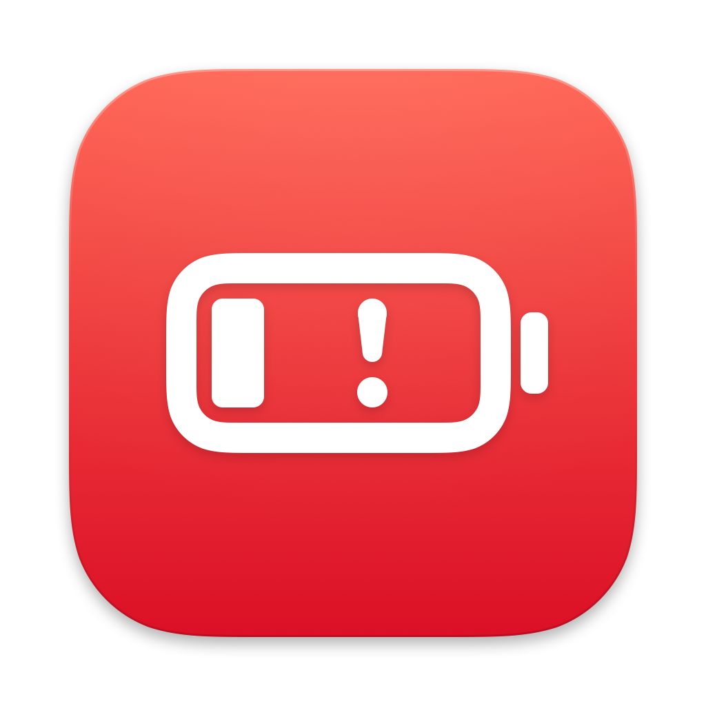
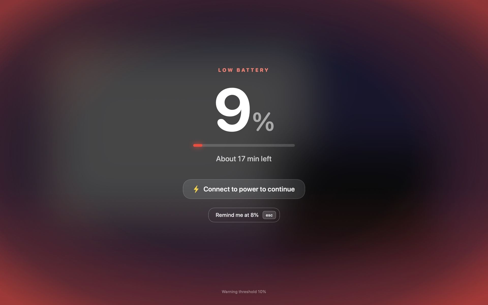
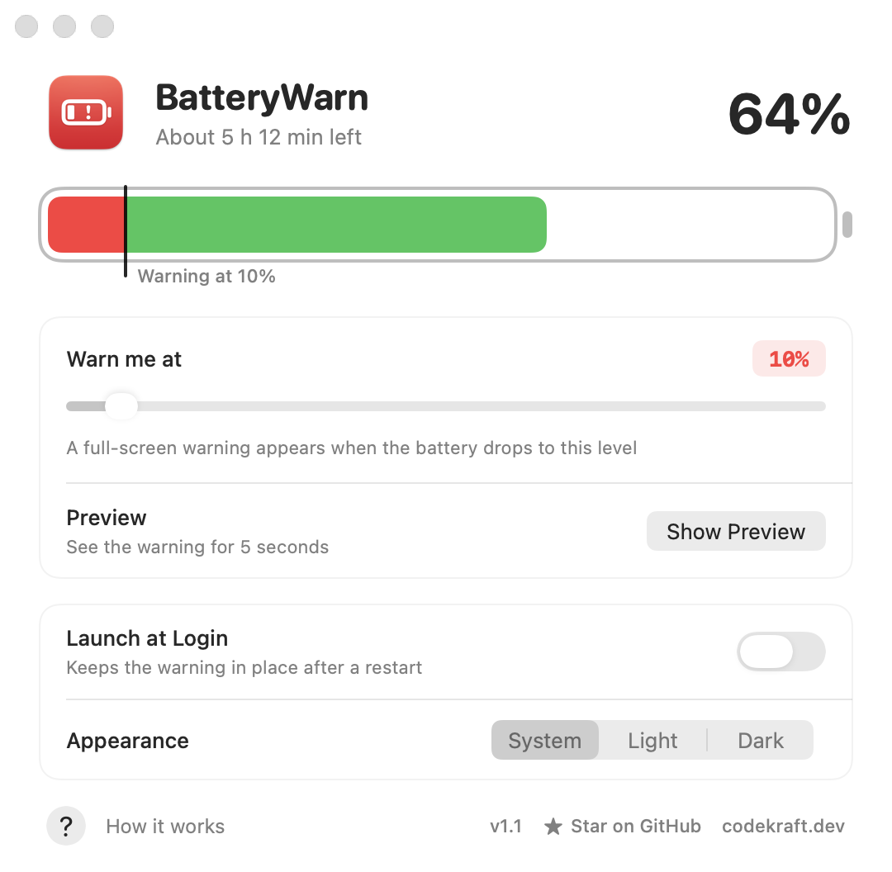
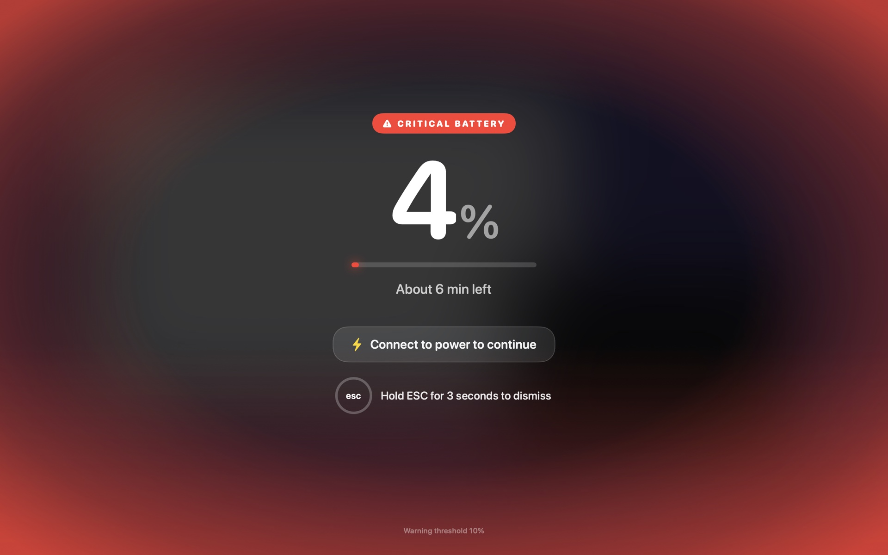

<p align="center">
  
</p>

<h1 align="center">BatteryWarn</h1>

A native macOS menu bar app that displays a full-screen warning when your MacBook battery drops to a customizable threshold. Never let your MacBook die unexpectedly again.




## Features

- **Full-Screen Warning** - Blurs and dims your screen under red light, with the battery level in huge type
- **Time Remaining** - Shows how long the battery will last, as estimated by macOS
- **Customizable Threshold** - Drag the marker on the battery in Settings, anywhere between 5% and 99%
- **Two Warning Modes**:
  - **Warning Mode (6-99%)** - Dismissable with ESC or button, reminds again at next % drop
  - **Critical Mode (≤5%)** - Requires holding ESC for 3 seconds to dismiss
- **Dismissable or Not** - Turn off dismissing and the warning stays until power is connected
- **Stays Up to Date** - An open warning follows the battery level and turns critical on its own
- **Auto-Dismiss** - Overlay disappears automatically when power is connected
- **Launch at Login** - Optional, so the warning is still there after a restart
- **Sleep-Friendly** - Doesn't prevent your Mac from sleeping
- **Multi-Monitor Support** - Overlay appears on all connected displays
- **Menu Bar App** - Lives quietly in your menu bar with dynamic battery icon and status
- **Light and Dark** - Settings follow the system appearance, or the one you pick
- **Native macOS** - Built with SwiftUI, no Electron, minimal resource usage

## Screenshots

**Settings** - The battery bar shows the current charge. Drag the marker on it to set where the warning starts.

<p align="center">
  <picture>
    <source media="(prefers-color-scheme: dark)" srcset="screenshots/settings-dark.png">
    
  </picture>
</p>

**Critical mode** - At 5% and below, dismissing takes a 3 second hold on ESC.



## Installation

### Option 1: Download Release

Download the latest `.dmg` from the [Releases](https://github.com/rn54n/batterywarn/releases) page and drag BatteryWarn into your Applications folder.

### Option 2: Build from Source

**Requirements:**
- macOS 14.0 or later
- Xcode 15+ or Swift 5.9+

```bash
# Clone the repository
git clone https://github.com/rn54n/batterywarn.git
cd batterywarn

# Build the app bundle
./scripts/build-app.sh

# Install and run it
cp -R build/BatteryWarn.app /Applications/
open /Applications/BatteryWarn.app
```

## Usage

1. **Launch the app** - BatteryWarn appears in your menu bar
2. **Configure threshold** - Click the menu bar icon → Settings, then drag the marker on the battery
3. **Turn on Launch at Login** - So BatteryWarn keeps watching after a restart
4. **Test the overlay** - Use "Test Warning" in the menu or "Show Preview" in Settings
5. **Work normally** - The app monitors your battery in the background

### Keyboard Shortcuts

| Shortcut | Warning Mode | Critical Mode (≤5%) |
|----------|--------------|---------------------|
| `ESC` | Dismiss immediately | Hold for 3 seconds |

With the menu bar menu open, `⌘,` opens Settings and `⌘Q` quits the app.

With **Allow Dismissing** turned off in Settings, ESC and the dismiss button are disabled: the warning stays until you connect power.

### How It Works

1. **Battery drops to your threshold** → Warning overlay appears
2. **Dismiss the warning** → Overlay closes, will remind at next % drop
3. **Connect power** → Overlay disappears automatically
4. **Battery ≤5%** → Critical mode, must hold ESC for 3 seconds

## Building

```bash
# Debug build (bare binary, no app bundle)
swift build

# Run tests
swift test

# App bundle in build/BatteryWarn.app
./scripts/build-app.sh

# App bundle plus build/BatteryWarn.dmg
./scripts/build-app.sh --dmg
```

The app bundle is signed ad hoc, which is enough to run it on your own Mac. Launch at Login is only available from the app bundle, not from the bare `swift build` binary.

The icon and the screenshots are generated, too:

```bash
# Redraw AppIcon.png, AppIcon.iconset and AppIcon.icns
swift scripts/make-icon.swift

# Re-render screenshots/ from the real views
./scripts/make-screenshots.sh
```

## Project Structure

```
batterywarn/
├── Package.swift              # Swift Package Manager config
├── README.md
├── LICENSE
├── AppIcon.png / .iconset / .icns # App icon (generated)
├── screenshots/               # README screenshots (generated)
├── scripts/
│   ├── build-app.sh               # Builds the .app bundle and DMG
│   ├── make-icon.swift            # Draws the app icon
│   └── make-screenshots.sh        # Renders the screenshots
├── BatteryWarn/
│   ├── BatteryWarnApp.swift       # App entry point & AppDelegate
│   ├── BatteryMonitor.swift       # IOKit battery monitoring
│   ├── BatteryReading.swift       # Parsed power source snapshot
│   ├── WarningPolicy.swift        # When to warn, when to stay quiet
│   ├── BatteryFormat.swift        # Text for time remaining and menu
│   ├── OverlayModel.swift         # Overlay state & ESC hold logic
│   ├── OverlayView.swift          # SwiftUI overlay UI
│   ├── OverlayWindowController.swift  # Window management
│   ├── SettingsView.swift         # Settings UI
│   ├── SettingsWindow.swift       # Settings window setup
│   ├── AppAppearance.swift        # Light / dark / system choice
│   ├── LoginItem.swift            # Launch at login
│   └── Info.plist                 # App configuration
└── Tests/
    └── BatteryWarnTests/          # Unit tests & screenshot renderer
```

## Technical Details

- **Battery Monitoring**: Uses `IOKit.ps` for real-time battery status
- **Power Source Notifications**: Subscribes to system power events for instant updates
- **Window Management**: Uses `NSWindow` with appropriate window levels
- **Launch at Login**: Uses `SMAppService` from the ServiceManagement framework
- **No External Dependencies**: Pure Swift/SwiftUI implementation

## Contributing

Contributions are welcome! Please feel free to submit a Pull Request.

1. Fork the repository
2. Create your feature branch (`git checkout -b feature/AmazingFeature`)
3. Commit your changes (`git commit -m 'Add some AmazingFeature'`)
4. Push to the branch (`git push origin feature/AmazingFeature`)
5. Open a Pull Request

## Known Limitations

- Requires macOS 14.0 (Sonoma) or later
- Not available on the Mac App Store (sandbox restrictions)
- Overlay may not appear over some full-screen apps

## License

This project is licensed under the MIT License - see the [LICENSE](LICENSE) file for details.

## Author

Created by [@nowness0x](https://x.com/nowness0x)

## Acknowledgments

- Built with SwiftUI and IOKit
- Inspired by the need to never have a MacBook die during important work

---

**If you find this useful, consider giving it a ⭐ on GitHub!**
