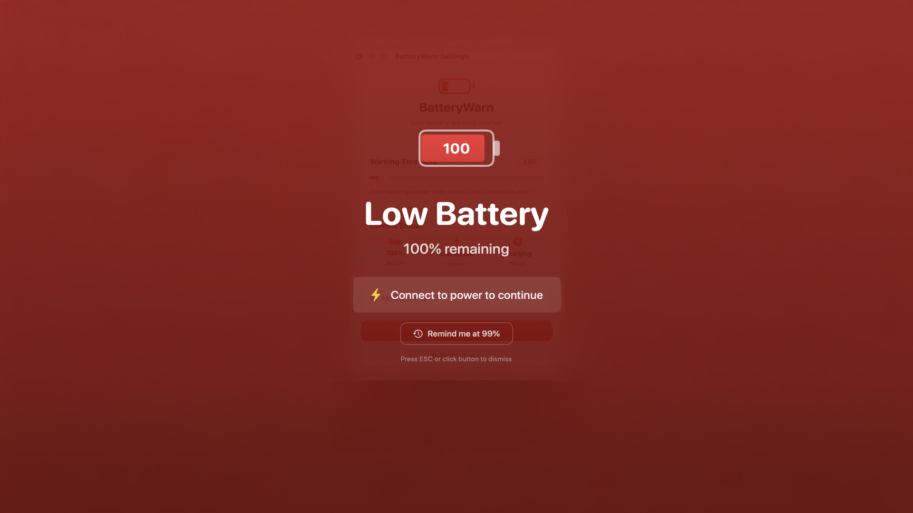

# BatteryWarn

A native macOS menu bar app that displays a full-screen warning overlay when your MacBook battery drops below a customizable threshold. Never let your MacBook die unexpectedly again.




## Features

- **Full-Screen Warning Overlay** - Impossible to miss red overlay when battery is low
- **Customizable Threshold** - Set your warning level between 5% and 99%
- **Two Warning Modes**:
  - **Warning Mode (6-99%)** - Dismissable with ESC or button, reminds again at next % drop
  - **Critical Mode (≤5%)** - Requires holding ESC for 3 seconds to dismiss
- **Auto-Dismiss** - Overlay disappears automatically when power is connected
- **Sleep-Friendly** - Doesn't prevent your Mac from sleeping
- **Multi-Monitor Support** - Overlay appears on all connected displays
- **Menu Bar App** - Lives quietly in your menu bar with dynamic battery icon
- **Native macOS** - Built with SwiftUI, no Electron, minimal resource usage

## Installation

### Option 1: Build from Source

**Requirements:**
- macOS 14.0 or later
- Xcode 15+ or Swift 5.9+

```bash
# Clone the repository
git clone https://github.com/rn54n/batterywarn.git
cd batterywarn

# Build the app
swift build -c release

# Run the app
./.build/release/BatteryWarn
```

### Option 2: Download Release

Download the latest `.dmg` from the [Releases](https://github.com/rn54n/batterywarn/releases) page.

## Usage

1. **Launch the app** - BatteryWarn appears in your menu bar
2. **Configure threshold** - Click the menu bar icon → Settings
3. **Test the overlay** - Use the "Test Warning Overlay" button
4. **Work normally** - The app monitors your battery in the background

### Keyboard Shortcuts

| Shortcut | Warning Mode | Critical Mode (≤5%) |
|----------|--------------|---------------------|
| `ESC` | Dismiss immediately | Hold for 3 seconds |
| `⌘,` | Open Settings | - |
| `⌘Q` | Quit app | - |

### How It Works

1. **Battery drops below threshold** → Warning overlay appears
2. **Dismiss the warning** → Overlay closes, will remind at next % drop
3. **Connect power** → Overlay disappears automatically
4. **Battery ≤5%** → Critical mode, must hold ESC for 3 seconds

## Building

```bash
# Debug build
swift build

# Release build
swift build -c release

# Run tests (if available)
swift test
```

## Project Structure

```
batterywarn/
├── Package.swift              # Swift Package Manager config
├── README.md
├── LICENSE
└── BatteryWarn/
    ├── BatteryWarnApp.swift       # App entry point & AppDelegate
    ├── BatteryMonitor.swift       # IOKit battery monitoring
    ├── OverlayView.swift          # SwiftUI overlay UI
    ├── OverlayWindowController.swift  # Window management
    ├── SettingsView.swift         # Settings UI
    └── Info.plist                 # App configuration
```

## Technical Details

- **Battery Monitoring**: Uses `IOKit.ps` for real-time battery status
- **Power Source Notifications**: Subscribes to system power events for instant updates
- **Window Management**: Uses `NSWindow` with appropriate window levels
- **No External Dependencies**: Pure Swift/SwiftUI implementation

## Contributing

Contributions are welcome! Please feel free to submit a Pull Request.

1. Fork the repository
2. Create your feature branch (`git checkout -b feature/AmazingFeature`)
3. Commit your changes (`git commit -m 'Add some AmazingFeature'`)
4. Push to the branch (`git push origin feature/AmazingFeature`)
5. Open a Pull Request

## Known Limitations

- Requires macOS 14.0 (Sonoma) or later
- Not available on the Mac App Store (sandbox restrictions)
- Overlay may not appear over some full-screen apps

## License

This project is licensed under the MIT License - see the [LICENSE](LICENSE) file for details.

## Author

Created by [@nowness0x](https://x.com/nowness0x)

## Acknowledgments

- Built with SwiftUI and IOKit
- Inspired by the need to never have a MacBook die during important work

---

**If you find this useful, consider giving it a ⭐ on GitHub!**
